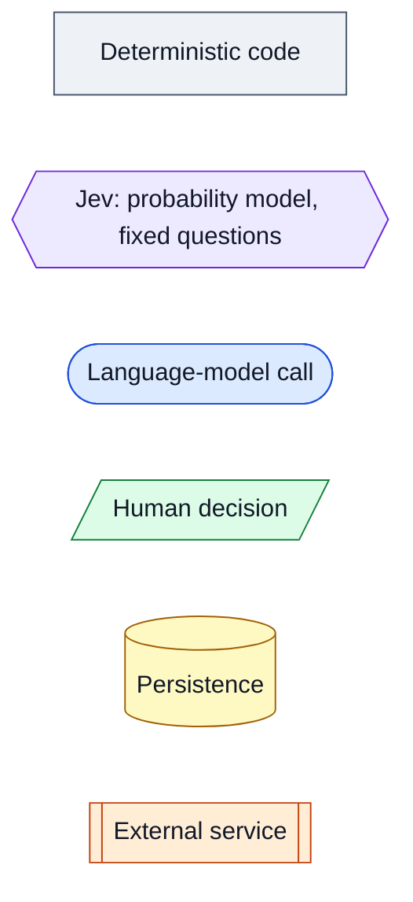

# Architecture — diagrams of the implemented system

*Diagrams describe Live `7322289` (2026-10-24) unless marked otherwise. Narrative: [Product 03](../product/03-system-architecture.md).*

| # | Diagram | Shows |
|---|---|---|
| 01 | [Components and boundaries](01-components.md) | Processes, modules, the governed model boundary, the database, external services |
| 02 | [Evidence admission and acceptance](02-evidence-admission.md) | Every path into the career record and who decides |
| 03 | [Requirement analysis and evidence matching](03-requirement-analysis-and-matching.md) | Posting → requirements → stories → assessment, with no language model |
| 04 | [Résumé planning, writing and review](04-resume-flow.md) | What each stage sees; where requirement text goes and where it never goes |
| 05 | [Discovery through application tracking](05-discovery-to-tracking.md) | Search → screen → assess → write → kit → fill → submit → status |
| 06 | [Measurement and feedback](06-measurement-and-feedback.md) | Call ledger, observability, model check, calibration, release loop |
| 07 | [Historical and planned architecture](07-historical-and-planned.md) | Earlier generations (not current) and planned work (not built), kept apart |

## Legend (used in every diagram)

Rendered SVG copies of every diagram are in [assets/diagrams/](../assets/diagrams/README.md), for
viewers that don't render Mermaid. The Mermaid source in these files is authoritative.
