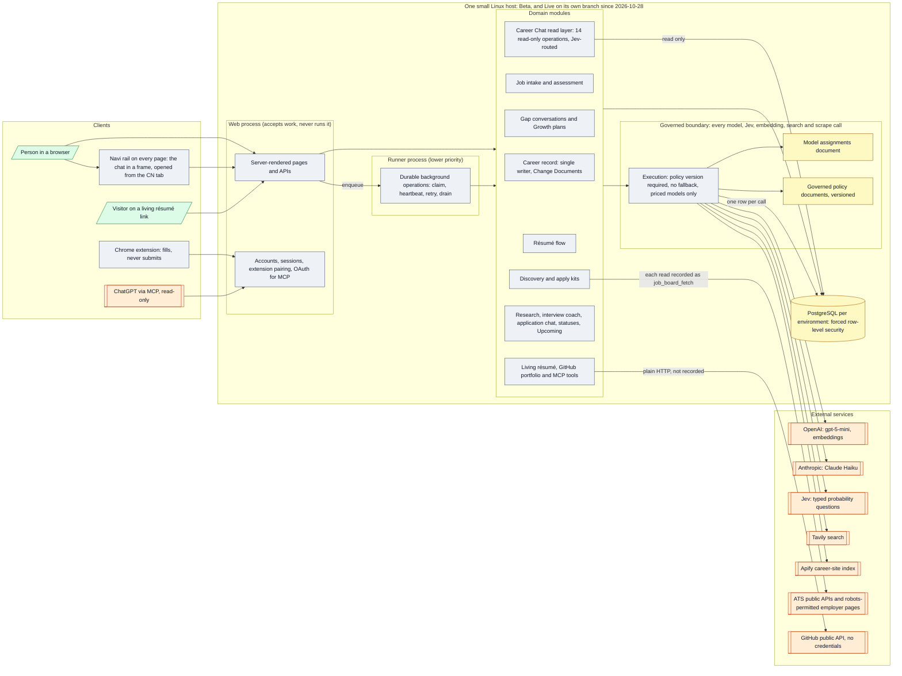

# Architecture 01 — Components and boundaries

*Live `00eac95` (2026-10-31) · narrative: [Product 03](../product/03-system-architecture.md)*

Since 2026-10-28 Live is deployed from its own branch, rebuilt from Beta's commits, without three
Beta-only evidence features ([P-37](../evidence/03-claim-index.md#p-37),
[DEC-50](../product/07-decision-log.md#dec-50)). The rail runs in the browser around every page and
adds no call ([A-106](../evidence/03-claim-index.md#a-106)).

## Boundaries the diagram encodes

| Boundary | Enforced by | Claim |
|---|---|---|
| Accounts never see each other | Forced row-level security; the runtime role owns nothing | [P-12](../evidence/03-claim-index.md#p-12) |
| Every model, Jev, embedding, search and scrape call goes through one boundary | Stage must be governed or declared; no fallback; priced models only; tests forbid provider calls elsewhere. GitHub's public API is read outside it, unrecorded | [P-01](../evidence/03-claim-index.md#p-01), [P-36](../evidence/03-claim-index.md#p-36), [D-28](../evidence/05-discrepancies.md#d-28) |
| The web process never runs slow work | Work is a committed row; the runner claims it | [P-09](../evidence/03-claim-index.md#p-09) |
| Only one module writes career evidence | Change Documents; text-scan test | [K-10](../evidence/03-claim-index.md#k-10), [K-11](../evidence/03-claim-index.md#k-11) |
| Career Chat only reads, and never reads what is excluded | Read operations only, tested by a statement listener; row-level security; no operation reads the written exclusions | [A-102](../evidence/03-claim-index.md#a-102), [P-33](../evidence/03-claim-index.md#p-33) |
| ChatGPT and living-résumé links can only read | No write tools or scope; the living-résumé engine imports no write path | [A-55](../evidence/03-claim-index.md#a-55), [A-56](../evidence/03-claim-index.md#a-56) |
| Portfolio artifacts are never evidence, and only those the owner made public are served | Their own tables; a link to evidence only by the owner's approval; served only from repositories approved for the living résumé | [K-34](../evidence/03-claim-index.md#k-34), [A-121](../evidence/03-claim-index.md#a-121) |
| GitHub is read without credentials | Public API only; no token exists to store | [A-120](../evidence/03-claim-index.md#a-120) |
| The extension cannot submit | No submit code path; test `the extension never submits` | [A-39](../evidence/03-claim-index.md#a-39) |
