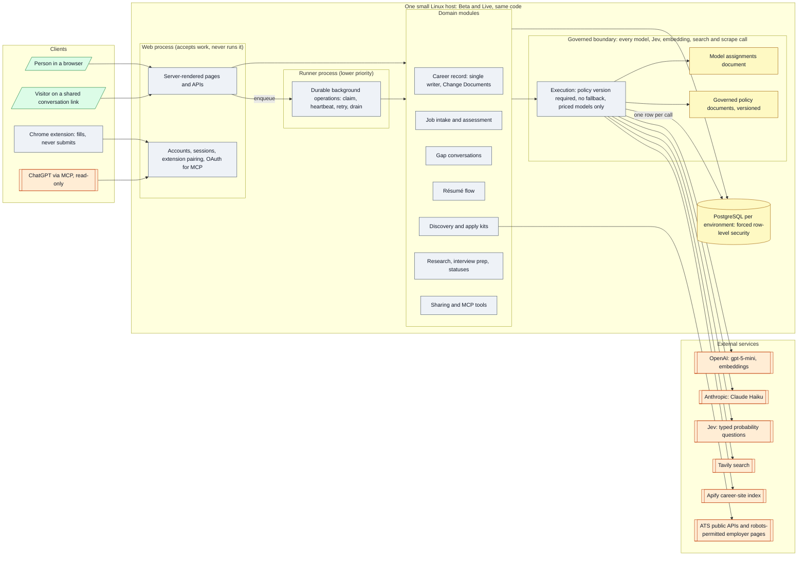

# Architecture 01 — Components and boundaries

*Live `7322289` (2026-10-24) · narrative: [Product 03](../product/03-system-architecture.md)*

## Boundaries the diagram encodes

| Boundary | Enforced by | Claim |
|---|---|---|
| Accounts never see each other | Forced row-level security; the runtime role owns nothing | [P-12](../evidence/03-claim-index.md#p-12) |
| Every outside call goes through one boundary | Stage must be governed or declared; no fallback; priced models only; tests forbid provider calls elsewhere | [P-01](../evidence/03-claim-index.md#p-01) |
| The web process never runs slow work | Work is a committed row; the runner claims it | [P-09](../evidence/03-claim-index.md#p-09) |
| Only one module writes career evidence | Change Documents; text-scan test | [K-10](../evidence/03-claim-index.md#k-10), [K-11](../evidence/03-claim-index.md#k-11) |
| ChatGPT and shared links can only read | No write tools or scope; the share engine imports no write path | [A-55](../evidence/03-claim-index.md#a-55), [A-56](../evidence/03-claim-index.md#a-56) |
| The extension cannot submit | No submit code path; test `the extension never submits` | [A-39](../evidence/03-claim-index.md#a-39) |
