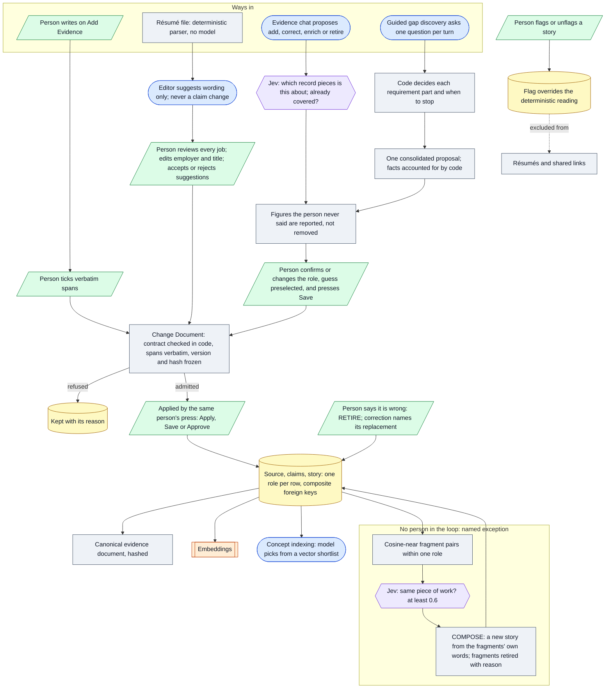

# Architecture 02 — Evidence admission and acceptance

*Live `7322289` (2026-10-24) · narrative: [Knowledge 02](../knowledge/02-admission-and-acceptance.md)*

**Not shown, because it is a known exception rather than the design:** "Accept as is" on a résumé
the person brought records it through the parser and approve step **without** the proposal page
([D-05](../evidence/05-discrepancies.md#d-05)).
