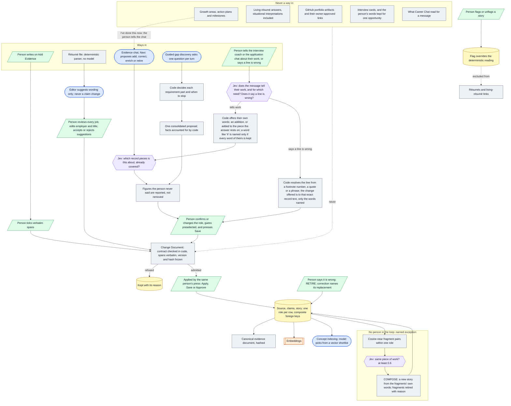

# Architecture 02 — Evidence admission and acceptance

*Live `00eac95` (2026-10-31) · narrative: [Knowledge 02](../knowledge/02-admission-and-acceptance.md)*

**New since 2026.10.0:**
- **Work told to the interview coach or the application chat is offered by code**, in the person's
  own words, and written only on Save ([A-65](../evidence/03-claim-index.md#a-65),
  [A-75](../evidence/03-claim-index.md#a-75)).
- **A line the person says is wrong is resolved by code**, and the change offered is to that exact
  record text; the coaching model cannot offer a removal ([A-69](../evidence/03-claim-index.md#a-69)).
- **Never a way in:** Growth plans ([K-33](../evidence/03-claim-index.md#k-33)); living-résumé
  interpretations ([A-114](../evidence/03-claim-index.md#a-114)); portfolio artifacts
  ([K-34](../evidence/03-claim-index.md#k-34)); interview cards and the person's words for one
  opportunity ([A-67](../evidence/03-claim-index.md#a-67), [A-70](../evidence/03-claim-index.md#a-70));
  what Career Chat reads ([K-31](../evidence/03-claim-index.md#k-31)). A Growth item reaches the
  record only when the person tells the chat what they did and saves it.

**Not shown, because they are known exceptions rather than the design:**
- "Accept as is" on a résumé the person brought records it through the parser and approve step
  **without** the proposal page ([D-05](../evidence/05-discrepancies.md#d-05)).
- Offers from the application chat skip the figure check that the evidence chat and the coach run
  ([D-36](../evidence/05-discrepancies.md#d-36)).
