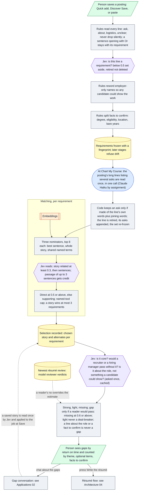

# Architecture 03 — Requirement analysis and evidence matching

*Live `00eac95` (2026-10-31) · narrative: [Applications 01](../applications/01-job-analysis-and-assessment.md) · one language-model call on this path, a stated exception: reading a line that lists several asks ([A-05](../evidence/03-claim-index.md#a-05))*

**The model exception.** Since 2026-10-27 one model call per posting (Claude Haiku by assignment,
[D-27](../evidence/05-discrepancies.md#d-27)) reads that posting's long listing lines at Chart My
Course, chosen by the product owner over rules; code admits only asks made of the line's own words
(plus joining words such as "and", "experience", "ability") ([A-05](../evidence/03-claim-index.md#a-05)). A sentence opening with "Or" stays with its requirement
([A-95](../evidence/03-claim-index.md#a-95)). A story saved from a gap updates the job's selection at Save with no new charting
([A-81](../evidence/03-claim-index.md#a-81)). Gaps are counted by theme on every page ([A-78](../evidence/03-claim-index.md#a-78)).

**Calibration note.** The 0.6 threshold and the "light is never a deal-breaker" rule were measured
against the app's *model* reviewer verdicts on one account's résumés (19, then 55). They are not
measured against human hiring outcomes ([M-13](../evidence/04-metric-ledger.md#m-13)–[M-15](../evidence/04-metric-ledger.md#m-15)).
