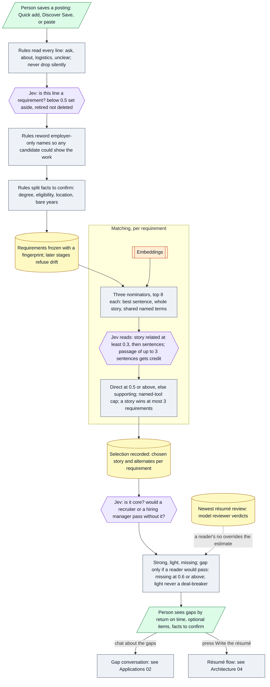

# Architecture 03 — Requirement analysis and evidence matching

*Live `7322289` (2026-10-24) · narrative: [Applications 01](../applications/01-job-analysis-and-assessment.md) · no language-model call anywhere on this path ([A-05](../evidence/03-claim-index.md#a-05))*

**Calibration note.** The 0.6 threshold and the "light is never a deal-breaker" rule were measured
against the app's *model* reviewer verdicts on one account's résumés (19, then 55). They are not
measured against human hiring outcomes ([M-13](../evidence/04-metric-ledger.md#m-13)–[M-15](../evidence/04-metric-ledger.md#m-15)).
