# Architecture 04 — Résumé planning, writing and review

*Live `7322289` (2026-10-24) · narrative: [Applications 03](../applications/03-resume-planning-writing-review.md) · case study: [02](../case-studies/02-preventing-unsupported-claims.md)*

The red dashed edge marks where the job's requirement text flows. It reaches the **selector** and
the **reviewers**. It never reaches the **writer**, the **editor** or **Fix**.

```mermaid
flowchart TD
  PRESS[/Person presses Write the résumé; refused without an assessment/]:::human
  PRESS --> SEL[Selection from the frozen reading: chosen story and alternates per requirement]:::det
  SEL --> FLAG[Flagged stories removed; the person's flag overrides]:::det
  FLAG --> SHARED{{Jev: do two stories state the same fact? cosine 0.70, then at least 0.85}}:::jev
  SHARED --> POOL[Per-role pool of numbered whole stories]:::det

  REQ[(Job requirements R1 to Rn)]:::store

  subgraph Section["For every section, in parallel"]
    PICK([Selector picks story numbers]):::model
    COPY[Code copies the picked stories verbatim]:::det
    GUARD[Guard: a writer prompt carrying the requirements block is refused]:::det
    DRAFT([Writer drafts; each bullet tagged with its story number, schema enum]):::model
    KEEP([Selector keeps draft pieces by number]):::model
    TIGHT([Writer tightens kept pieces to fixed shapes]):::model
  end
  POOL --> PICK
  REQ -.->|requirements| PICK
  REQ -.->|requirements| KEEP
  PICK -->|numbers only| COPY --> GUARD --> DRAFT --> KEEP -->|numbers only| TIGHT

  TIGHT --> STORE[(Bullets stored UNGROUNDED with their story id; database refuses a cross-role citation)]:::store
  STORE --> COMPS([Competencies from bullets only; uncited ones dropped]):::model
  COMPS --> FIT[Printed-page fit: cut from the end of the selector's order; never empty a role]:::det
  FIT --> REVW([Two reviewer seats: recruiter and hiring manager; report only]):::model
  REQ -.->|requirements without eligibility lines; education labelled a risk| REVW
  REVW --> EDIT([Editor reads the lines only]):::model
  EDIT --> GATE[Gate: no new figure or name, no negation change, at most 6 words]:::det
  GATE --> VERIFY([Editor verify read]):::model
  VERIFY --> LABEL{{Jev: repeated lines labelled, nothing removed}}:::jev
  LABEL --> READ[Readability measures: report only]:::det
  READ --> NEXT([What to do next: actions, e.g. add a missing result]):::model
  NEXT --> PERSON[/Person edits, reorders, removes; or presses Fix on a line/]:::human
  PERSON -->|Fix, at most 2 attempts| FIX([Line rewrite from its own evidence]):::model
  FIX --> FGATE[Gate: numbers, new words, relation and agency]:::det
  FGATE --> REVW

  linkStyle 5,6,16 stroke:#dc2626,stroke-width:2px,stroke-dasharray:5 5

  classDef det fill:#eef2f7,stroke:#475569,color:#111827
  classDef jev fill:#ede9fe,stroke:#6d28d9,color:#111827
  classDef model fill:#dbeafe,stroke:#1d4ed8,color:#111827
  classDef human fill:#dcfce7,stroke:#15803d,color:#111827
  classDef store fill:#fef9c3,stroke:#a16207,color:#111827
  classDef ext fill:#ffedd5,stroke:#c2410c,color:#111827
```

**What the diagram does not show, because it does not run on Live:**
- **Clause-level grounding.** The run records it as skipped ([K-23](../evidence/03-claim-index.md#k-23)).
- **The older flow's post-hoc checks**: relation, agency, copied phrases, named artifacts and figure
  conflicts ([A-20](../evidence/03-claim-index.md#a-20)).
