# Architecture 04 — Résumé planning, writing and review

*Live `00eac95` (2026-10-31) · narrative: [Applications 03](../applications/03-resume-planning-writing-review.md) · case study: [02](../case-studies/02-preventing-unsupported-claims.md)*

The **red dashed edges** mark where the job's own text flows. The requirement list reaches the
**selector** and the **reviewers**. The raw posting reaches the summary **planner** and a code check
for copied wording. Neither reaches any **writer** (bullet, summary or role), the **editor** or
**Fix**.

The **amber dashed edges** mark text a model wrote after reading the posting: the planner's needs,
and the brief it builds from them. The summary writers read that brief, without its
employer's-problem field. This is how the posting's vocabulary can reach a summary
([A-83](../evidence/03-claim-index.md#a-83)).

```mermaid
flowchart TD
  PRESS[/"Person presses Write the résumé; refused without an assessment"/]:::human
  PRESS --> SEL["Selection from the frozen reading: chosen story and alternates per requirement; stories retired since charting skipped"]:::det
  SEL --> FLAG["Flagged stories removed; the person's flag overrides"]:::det
  FLAG --> SHARED{{"Jev: do two stories state the same fact? cosine 0.70, then at least 0.85"}}:::jev
  SHARED --> POOL["Per-role pool of numbered whole stories"]:::det

  REQ[("Job requirements R1 to Rn")]:::store
  POST[("The posting text")]:::store

  subgraph Bullets["Bullets: every role at once"]
    PICK(["Selector picks story numbers"]):::model
    COPY["Code copies the picked stories verbatim"]:::det
    GUARD["Guard: a writer prompt carrying the requirements block is refused"]:::det
    DRAFT(["Writer drafts each bullet as its finished line: story number by schema enum, what was done, at most two results, the line"]):::model
    KEEP(["Selector keeps bullets by number"]):::model
    LONG{"Longer than two printed lines, 220 characters?"}:::det
    TIGHT(["Writer shortens only those, to at most 25 words, each in its own place"]):::model
  end

  STORE[("Bullets stored UNGROUNDED with their story id; database refuses a cross-role citation")]:::store

  subgraph Summaries["Summaries: started beside the bullets"]
    NEEDS(["Planner reads the posting: purpose and 3 to 5 needs"]):::model
    JOURNEY(["Career journey written once from the stories, when none is saved"]):::model
    MATCH{{"Jev classes each story against each need: direct or transferable, at 0.5"}}:::jev
    PLAIN(["Stories, journey and role summaries restated in plain words; kept for reuse"]):::model
    BRIEF(["Planner writes the positioning brief; assertions cite stories by enum (not required)"]):::model
    BCHK{{"Jev reads each brief assertion against its original stories; reported"}}:::jev
    WRITE(["Professional summary writer: three schema fields; a guard refuses the opening of any long requirement or posting line"]):::model
    ROLEW(["One writer per role with bullets, all at once: 1 to 3 sentences by schema"]):::model
    VER{{"Jev reads each sentence against the original stories it cites"}}:::jev
    CODEF["Code flags: opener, figures, tool lists, logistics, copied posting wording, length"]:::det
    PLACE["Placed as written, never replaced; findings kept with the run"]:::det
  end

  POOL --> PICK
  REQ -.->|requirements| PICK
  REQ -.->|requirements| KEEP
  PICK -->|numbers only| COPY
  COPY --> GUARD
  GUARD --> DRAFT
  DRAFT --> KEEP
  KEEP -->|numbers only| LONG
  LONG -->|yes| TIGHT
  LONG -->|no| STORE
  TIGHT --> STORE

  POST -.->|the posting| NEEDS
  NEEDS --> MATCH
  FLAG -->|unflagged stories of the roles that may get bullets| MATCH
  MATCH -->|matched stories| PLAIN
  JOURNEY --> PLAIN
  NEEDS -.->|the planner's reading of the posting| BRIEF
  PLAIN --> BRIEF
  STORE -->|the bullets| BRIEF
  BRIEF --> BCHK
  BRIEF -.->|brief without the employer's problem| WRITE
  BRIEF -.->|the role's pillars| ROLEW
  PLAIN -->|stories behind the role's bullets| ROLEW
  STORE -->|the role's bullets| ROLEW
  WRITE --> VER
  ROLEW --> VER
  VER --> CODEF
  POST -.->|compared for copied wording| CODEF
  CODEF --> PLACE

  STORE --> COMPS(["Competencies from bullets only; uncited ones dropped; written while the summaries finish"]):::model
  COMPS --> ENR["Enrichment waits for the summaries and stores them as written, UNGROUNDED"]:::det
  PLACE --> ENR
  ENR --> FIT["Printed-page fit on the exported PDF: cut from the end of the selector's order; never empty a role"]:::det
  FIT --> READ["Readability measures counted by code, shown to both seats"]:::det
  READ --> REVW(["Two reviewer seats: recruiter and hiring manager; report only"]):::model
  REQ -.->|requirements without eligibility lines; education labeled a risk| REVW
  FIT --> EDIT(["Editor reads the lines only, beside the reviewers"]):::model
  EDIT --> GATE["Gate: no new figure or name, no negation change, at most 6 words"]:::det
  GATE --> VERIFY(["Editor verify read"]):::model
  REVW --> LABEL{{"Jev: repeated lines labeled, nothing removed"}}:::jev
  VERIFY --> LABEL
  LABEL --> NEXT(["What to do next: actions, e.g. add a missing result"]):::model
  NEXT --> PAGE["Review page: numbered lines; findings shown on the summaries; red button where a summary is missing"]:::det
  PAGE --> PERSON[/"Person rewords, reorders, removes (no review starts); presses Fix or the red button; downloads"/]:::human
  PERSON -->|a reworded line| CITE{{"Jev reads what its new words show; cited only for that; cached"}}:::jev
  PERSON -->|red button| MISS(["Writes only the missing summary from the build's own brief (or a new one when none was kept); findings shown; not reviewed again"]):::model
  PERSON -->|Fix a line, at most 2 attempts| FIX(["Line rewrite from its own evidence; never a summary on these résumés"]):::model
  FIX --> FGATE["Gate: numbers, new words, relation and agency"]:::det
  FGATE --> REVW
  PERSON -->|download| PDF["The same PDF export the page fit measured"]:::det

  linkStyle 5,6,15,31,39 stroke:#dc2626,stroke-width:2px,stroke-dasharray:5 5
  linkStyle 20,24,25 stroke:#c2410c,stroke-width:2px,stroke-dasharray:3 3

  classDef det fill:#eef2f7,stroke:#475569,color:#111827
  classDef jev fill:#ede9fe,stroke:#6d28d9,color:#111827
  classDef model fill:#dbeafe,stroke:#1d4ed8,color:#111827
  classDef human fill:#dcfce7,stroke:#15803d,color:#111827
  classDef store fill:#fef9c3,stroke:#a16207,color:#111827
  classDef ext fill:#ffedd5,stroke:#c2410c,color:#111827
```

**What runs at the same time:**
- The summaries' preparation (needs, the career journey when missing, Jev's classes, plain words)
  runs beside the bullets ([A-88](../evidence/03-claim-index.md#a-88)).
- Every role's bullets are written at once.
- The professional summary writer and every role writer run at once.
- Competencies are written while the summaries finish. Enrichment waits for the summaries.
- The two reviewer seats and the editor run at once. The repeat labels follow both.

**What the diagram does not show, because it does not run on Live:**
- **Clause-level grounding.** The run records it as skipped ([K-23](../evidence/03-claim-index.md#k-23)).
- **The older flow's post-hoc checks**: relation, agency, copied phrases, named artifacts and figure
  conflicts ([A-20](../evidence/03-claim-index.md#a-20)).
- **The earlier summary paths**: the four-step summaries and the summary tool. Both are still in the
  code with no caller ([A-101](../evidence/03-claim-index.md#a-101)).
- **The polish experiment** (Beta, closed; [A-97](../evidence/03-claim-index.md#a-97)).
- **Beta-only work**: writing-quality measurements, optional subheadings, and career themes, major
  outcomes and the evidence timeline ([A-98](../evidence/03-claim-index.md#a-98)–[A-100](../evidence/03-claim-index.md#a-100)).
