# Architecture 05 — Discovery through application tracking

*Live `00eac95` (2026-10-31) · narrative: [Applications 04](../applications/04-discovery-to-application.md) · case study: [04](../case-studies/04-connecting-discovery-to-application.md)*

```mermaid
flowchart TD
  PROF[/Person reviews a search profile built from their own roles; must, preference or unknown/]:::human
  PROF --> RUN[Run: Search now, a daily or weekly schedule, or a 6-hourly watch of chosen boards]:::det
  RUN --> Q[Queries from roles, kinds of work and places; health and disability terms dropped]:::det
  Q --> SRC[[ATS public APIs; robots-permitted employer pages; public feeds; domain-limited web search]]:::ext
  Q --> IDX[[Hosted career-site index: admin account only, own monthly cap]]:::ext
  SRC --> NORM[Verify, normalize, de-duplicate: ids, requisitions, URLs; never merge two ATS ids]:::det
  IDX --> NORM
  NORM --> CLOSE[[Embeddings: closeness of title and opening to the person's roles, at least 0.5]]:::ext
  CLOSE --> PRAC[Practical rules: only a must against a stated fact excludes; remote never assumed open; to-check list]:::det
  PRAC --> EVID{{Jev on up to 6 requirement lines of readable postings: keep at least 0.5}}:::jev
  EVID --> TIER[Tier and priority; unread or unverified never recommended]:::det
  TIER --> OPEN[(Openings with state: new, seen, updated, repost, closed only when the ATS stops listing)]:::store
  OPEN --> QUEUE[/Person: Save, Save anyway, Not interested, Already applied/]:::human
  OPEN -.->|scheduled runs only, at most 3 per run| AUTO[Auto-assess for review; never write]:::det

  QUEUE --> JOB[(Opportunity with frozen requirements; Needs details if unread)]:::store
  AUTO --> JOB
  JOB --> ASSESS[Chart My Course: assessment, see Architecture 03]:::det
  ASSESS --> CHAT[/Person chats about the gaps, optional/]:::human
  CHAT -->|"a saved story: Jev reads it once, code applies it, no re-charting"| ASSESS
  CHAT --> WRITE[/Person presses Write the résumé, see Architecture 04/]:::human
  WRITE --> LBL["Pane label: Ready to apply or N gaps, by the page's own rule, a theme counted as one gap; kept with its basis, recounted in the background when stale"]:::det
  LBL --> KIT[Apply kit: read the Greenhouse form; code assigns each question's source]:::det
  KIT --> KJ{{Jev picks evidence per question}}:::jev
  KJ --> KM([Draft experience answers and a cover letter, enforced shape]):::model
  KM --> KADMIT[Flag unsupported figures, promises and commitments; EEO never filled, kept or sent]:::det
  KADMIT --> FILL[Extension fills fields and attaches the résumé; shows answers beside menus it cannot open]:::det

  KIT -->|"Need help preparing my application"| AROLE(["Role read from the posting alone, kept; one question read into its parts"]):::model
  AROLE --> AJ{{"Jev picks claims per part: one piece of work for an example; their stated reasons only where Jev reads them as reasons for this job"}}:::jev
  AJ --> AW(["Application chat writes the answer; never shown the record; every line cites its sources"]):::model
  AW --> ACHK{{"Jev checks each line; code reports unsupported lines, length and labels, never repairs"}}:::jev
  ACHK --> AUSE[/"Person presses Use this answer: into the kit field; nothing submitted"/]:::human
  AUSE --> FILL
  AW -.->|"told work offered as an addition to the piece"| ASAVE[/"Person saves it to the record: see Architecture 02"/]:::human

  FILL --> SUBMIT[/Person answers eligibility, pay and EEO, picks menus, and submits on the employer's site/]:::human
  SUBMIT --> MARK[/Person marks it applied, then later statuses/]:::human
  MARK --> EVT[(Status events; undo is a new event; Rejected is distinct from Declined offer)]:::store
  EVT --> ACT[Activity card: applied, entered interviewing, rejected over 24 h, 7 d, 30 d, dated history only]:::det
  MARK -.->|Interviewing| DAY[/"Person gives the interview day in the box under the status"/]:::human
  DAY --> UP[("Upcoming card: dated items soonest first; past dates and closed opportunities drop off; code only")]:::store
  UP --> COACH["Interview coach: see Architecture 08"]:::det
  COACH -->|"debrief saved: the next interview's day"| UP

  QUEUE -.->|known gap: Already applied writes no status event| EVT

  classDef det fill:#eef2f7,stroke:#475569,color:#111827
  classDef jev fill:#ede9fe,stroke:#6d28d9,color:#111827
  classDef model fill:#dbeafe,stroke:#1d4ed8,color:#111827
  classDef human fill:#dcfce7,stroke:#15803d,color:#111827
  classDef store fill:#fef9c3,stroke:#a16207,color:#111827
  classDef ext fill:#ffedd5,stroke:#c2410c,color:#111827
```

**Not shown.** For Lever and Ashby, and any form the kit can't read, the form-reading step is
skipped: the person adds the application's questions word for word, on the kit or in the
application chat, and the extension can't fill that form
([A-40](../evidence/03-claim-index.md#a-40)).

**What to notice:**
- The application chat's writer is never shown the record; Jev chooses what it may cite and checks
  every line, and code reports what fails ([A-73](../evidence/03-claim-index.md#a-73)). Nothing on
  this path submits an application.
- A gap's saved story updates the job's reading without charting again
  ([A-81](../evidence/03-claim-index.md#a-81)).
- The pane label is counted by the same rule as the opportunity page and is never shown stale
  ([A-79](../evidence/03-claim-index.md#a-79), [A-78](../evidence/03-claim-index.md#a-78)).
- Interview days come only from the person, or from a debrief they save; code orders them
  ([A-72](../evidence/03-claim-index.md#a-72)).
