# Architecture 05 — Discovery through application tracking

*Live `7322289` (2026-10-24) · narrative: [Applications 04](../applications/04-discovery-to-application.md) · case study: [04](../case-studies/04-connecting-discovery-to-application.md)*

```mermaid
flowchart TD
  PROF[/Person reviews a search profile built from their own roles; must, preference or unknown/]:::human
  PROF --> RUN[Run: Search now, a daily or weekly schedule, or a 6-hourly watch of chosen boards]:::det
  RUN --> Q[Queries from roles, kinds of work and places; health and disability terms dropped]:::det
  Q --> SRC[[ATS public APIs; robots-permitted employer pages; public feeds; domain-limited web search]]:::ext
  Q --> IDX[[Hosted career-site index: admin account only, own monthly cap]]:::ext
  SRC --> NORM[Verify, normalise, de-duplicate: ids, requisitions, URLs; never merge two ATS ids]:::det
  IDX --> NORM
  NORM --> CLOSE[[Embeddings: closeness of title and opening to the person's roles, at least 0.5]]:::ext
  CLOSE --> PRAC[Practical rules: only a must against a stated fact excludes; remote never assumed open; to-check list]:::det
  PRAC --> EVID{{Jev on up to 6 requirement lines of readable postings: keep at least 0.5}}:::jev
  EVID --> TIER[Tier and priority; unread or unverified never recommended]:::det
  TIER --> OPEN[(Openings with state: new, seen, updated, repost, closed only when the ATS stops listing)]:::store
  OPEN --> QUEUE[/Person: Save, Save anyway, Not interested, Already applied/]:::human
  OPEN -.->|scheduled runs only, at most 3 per run| AUTO[Auto-assess for review; never write]:::det

  QUEUE --> JOB[(Opportunity with frozen requirements; Needs details if unread)]:::store
  AUTO --> JOB
  JOB --> ASSESS[Chart My Course: assessment, see Architecture 03]:::det
  ASSESS --> CHAT[/Person chats about the gaps, optional/]:::human
  CHAT --> WRITE[/Person presses Write the résumé, see Architecture 04/]:::human
  WRITE --> KIT[Apply kit: read the Greenhouse form; code assigns each question's source]:::det
  KIT --> KJ{{Jev picks evidence per question}}:::jev
  KJ --> KM([Draft experience answers and a cover letter, enforced shape]):::model
  KM --> KADMIT[Flag unsupported figures, promises and commitments; EEO never filled, kept or sent]:::det
  KADMIT --> FILL[Extension fills fields and attaches the résumé; shows answers beside menus it cannot open]:::det
  FILL --> SUBMIT[/Person answers eligibility, pay and EEO, picks menus, and submits on the employer's site/]:::human
  SUBMIT --> MARK[/Person marks it applied, then later statuses/]:::human
  MARK --> EVT[(Status events; undo is a new event; Rejected is distinct from Declined offer)]:::store
  EVT --> ACT[Activity card: applied, entered interviewing, rejected over 24 h, 7 d, 30 d, dated history only]:::det

  QUEUE -.->|known gap: Already applied writes no status event| EVT

  classDef det fill:#eef2f7,stroke:#475569,color:#111827
  classDef jev fill:#ede9fe,stroke:#6d28d9,color:#111827
  classDef model fill:#dbeafe,stroke:#1d4ed8,color:#111827
  classDef human fill:#dcfce7,stroke:#15803d,color:#111827
  classDef store fill:#fef9c3,stroke:#a16207,color:#111827
  classDef ext fill:#ffedd5,stroke:#c2410c,color:#111827
```

Lever and Ashby jobs skip the form-reading step and get a résumé-only kit
([A-40](../evidence/03-claim-index.md#a-40)).
