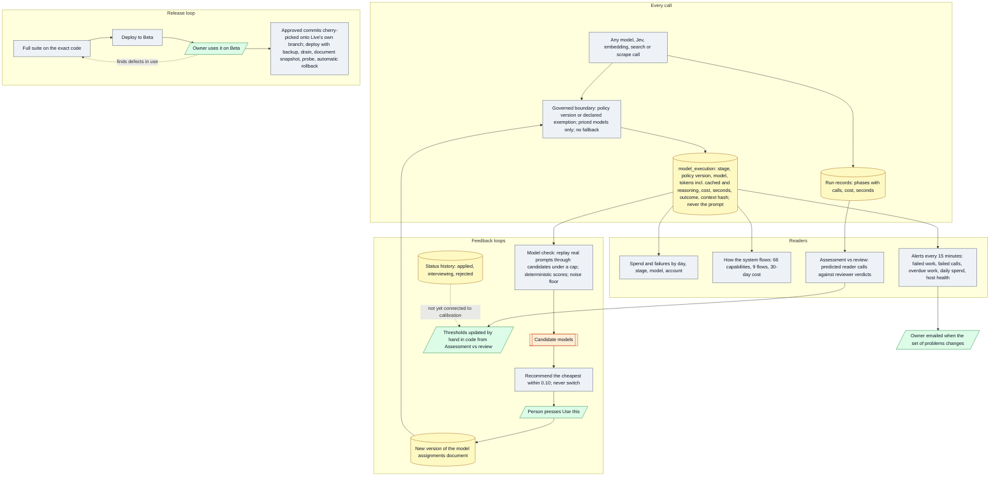

# Architecture 06 — Measurement and feedback

*Live `00eac95` (2026-10-31) · narrative: [Product 05](../product/05-quality-and-measurement.md), [Product 06](../product/06-operations-and-privacy.md)*

**Gaps the diagram makes visible:**
- Status history does not feed calibration.
- Per-call seconds are missing for the writer, selector and reviewers
  ([P-17](../evidence/03-claim-index.md#p-17)).
- Model check has not yet been run on Live ([P-07](../evidence/03-claim-index.md#p-07)).
- Per-call seconds are also missing for the résumé summary calls, and an interview-coach turn stores
  no time on the turn ([D-21](../evidence/05-discrepancies.md#d-21)).
- A model named only in the seed file never reaches an existing database's assignments document,
  so the routing loop starts from what Admin › Models holds ([D-27](../evidence/05-discrepancies.md#d-27)).
- GitHub reads for the portfolio go around the governed boundary and write no ledger row
  ([P-36](../evidence/03-claim-index.md#p-36), [D-28](../evidence/05-discrepancies.md#d-28)). ATS reads also go around it but are recorded.
- Since 2026-10-28 the release loop ends on Live's own branch, rebuilt from Beta's commits by
  cherry-pick, without three Beta-only features ([P-37](../evidence/03-claim-index.md#p-37)).
