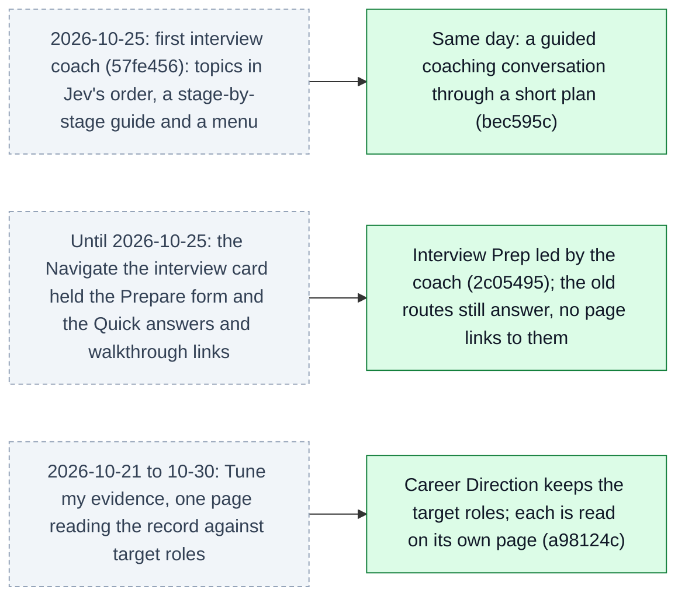

# Architecture 07 — Historical and planned architecture

*Nothing in this file describes the current system* (Live `00eac95`, 2026-10-31). Current diagrams are [01](01-components.md)–[06](06-measurement-and-feedback.md) and [08](08-interview-coach.md).
The full narrative is in [EVOLUTION](../EVOLUTION.md); planned work is in [ROADMAP](../ROADMAP.md).

## Historical: how the architecture got here (superseded)

```mermaid
flowchart LR
  L0["2026-07-08: three layer documents, Knowledge 2.2, Product 3.0, Application 3.0; no software"]:::hist
  G0["07-17 to 08-06: predecessor; Markdown libraries in git as truth; Open WebUI front end; local generation; never deployed"]:::hist
  G1["08-06: V1, proposals as the only intake; gap analysis in plain code"]:::hist
  G3["08-07 to 08-10: labs; local-only inference; only acceptance makes knowledge"]:::hist
  G5["08-11 to 08-17: semantic validators; measurement starts contradicting the product; QC-1"]:::hist
  G6["08-18 to 09-03: capability and competency graph; findings ledger"]:::hist
  G7["09-06: hosted, multi-user Live on PostgreSQL"]:::hist
  G8["09-14 to 09-17: derived and persisted demands; repeatability from persistence"]:::hist
  G10["09-24 to 09-28: Bounded Fit, one coherent body of work; capability as an address"]:::hist
  G11["09-28 to 09-29: Express one-press résumé (the baseline, 38f4bbf)"]:::hist
  X["10-03: extraction into a clean application; schema-level boundaries"]:::now
  L0 --> G0 --> G1 --> G3 --> G5 --> G6 --> G7 --> G8 --> G10 --> G11 --> X

  classDef hist fill:#f1f5f9,stroke:#94a3b8,color:#334155,stroke-dasharray:4 3
  classDef now fill:#dcfce7,stroke:#15803d,color:#111827
```

**What did not carry forward.** These parts of the earlier designs were never built, or were built
and removed:
- the Learning engine and the Persona system;
- standalone cover letters (they exist only as drafted kit answers), executive biography, promotion
  packets and performance-review support;
- per-capability approval;
- the human acceptance gate;
- per-piece model judging;
- the Staged Planner's page-fitting stages;
- deploy overrides;
- local-only inference;
- the separate Observatory process.

The reasons are in [EVOLUTION](../EVOLUTION.md) and the [decision log](../product/07-decision-log.md).

## Historical: replaced since the 2026.10.0 release (superseded)

Each pair is an earlier design (dashed) and what replaced it. The replacements are current and
described in the section documents.

- **The first coach** worked through topics in Jev's order, with a guide from explaining to finding
  experience, checking, practice and feedback, and a menu. Corrected the same day. **Owner:** "a
  guided coaching conversation" (`bec595c`, [DEC-37](../product/07-decision-log.md#dec-37),
  [A-61](../evidence/03-claim-index.md#a-61)).
- **The Navigate the interview card** went so the coach's preparation leads the page. Round
  preparation, Quick answers and the walkthrough are still served, but no page links to them
  ([DEC-41](../product/07-decision-log.md#dec-41), [A-52](../evidence/03-claim-index.md#a-52),
  [D-39](../evidence/05-discrepancies.md#d-39)).
- **Tune my evidence** was retired with the CN tab and the four-page menu; its addresses lead to
  Career Direction ([A-107](../evidence/03-claim-index.md#a-107),
  [DEC-68](../product/07-decision-log.md#dec-68)).

## Planned: what is designed or requested but not built

Dashed nodes are **not implemented**. Solid nodes show where each one would attach to the current
system.

```mermaid
flowchart TD
  RES[Résumé flow, current]:::now --> P1[Automated support report on Live résumés, measurement not gate]:::plan
  RES --> P2[First-pass writer quality vs editor fixes, per the project rules]:::plan
  ASSESS[Assessment, current]:::now --> P3[Join real outcomes from status history to calibration]:::plan
  STAT[Status history, current]:::now --> P4[Rejection-stage tracking]:::plan
  STAT --> P5[Referral asks and outcomes]:::plan
  REC[Career record, current]:::now --> P6[Restore retired evidence]:::plan
  REC --> P7[Lineage edges written in production]:::plan
  KIT[Apply kit, current]:::now --> P8[Read Lever and Ashby forms from the open page via the extension]:::plan
  SEL[Story selection, current model call]:::now --> P9[Selection and gap-panel judgment moved to Jev]:::plan
  APP[Web app, current]:::now --> P10[Phone app release: branch exists, not merged]:::plan
  SHR[Living résumé and GitHub portfolio, current]:::now --> P11["GitHub sign-in through a GitHub App: private repositories and proof the account is the owner's"]:::plan
  SHR --> P12["A reader for repositories marked for my preparation: the level is stored, nothing reads it"]:::plan
  READS[Career Chat read layer, current]:::now --> P13["Questions across the record: which requirements most often lack direct evidence; which evidence is used most in interviews; which reviewer concerns went away after evidence was added"]:::plan

  classDef now fill:#dcfce7,stroke:#15803d,color:#111827
  classDef plan fill:#ffffff,stroke:#64748b,color:#334155,stroke-dasharray:5 4
```

The three newest planned nodes: GitHub sign-in ([A-122](../evidence/03-claim-index.md#a-122)); the
preparation level, stored but read by nothing ([D-30](../evidence/05-discrepancies.md#d-30)); and the
cross-record questions that the read layer's coverage document lists as not built yet.
