# Architecture 07 — Historical and planned architecture

*Nothing in this file describes the current system.* Current diagrams are [01](01-components.md)–[06](06-measurement-and-feedback.md).
The full narrative is in [EVOLUTION](../EVOLUTION.md); planned work is in [ROADMAP](../ROADMAP.md).

## Historical: how the architecture got here (superseded)

```mermaid
flowchart LR
  L0["2026-07-08: three layer documents, Knowledge 2.2, Product 3.0, Application 3.0; no software"]:::hist
  G0["07-17 to 08-06: predecessor; Markdown libraries in git as truth; Open WebUI front end; local generation; never deployed"]:::hist
  G1["08-06: V1, proposals as the only intake; gap analysis in plain code"]:::hist
  G3["08-07 to 08-10: labs; local-only inference; only acceptance makes knowledge"]:::hist
  G5["08-11 to 08-17: semantic validators; measurement starts contradicting the product; QC-1"]:::hist
  G6["08-18 to 09-03: capability and competency graph; findings ledger"]:::hist
  G7["09-06: hosted, multi-user Live on PostgreSQL"]:::hist
  G8["09-14 to 09-17: derived and persisted demands; repeatability from persistence"]:::hist
  G10["09-24 to 09-28: Bounded Fit, one coherent body of work; capability as an address"]:::hist
  G11["09-28 to 09-29: Express one-press résumé (the baseline, 38f4bbf)"]:::hist
  X["10-03: extraction into a clean application; schema-level boundaries"]:::now
  L0 --> G0 --> G1 --> G3 --> G5 --> G6 --> G7 --> G8 --> G10 --> G11 --> X

  classDef hist fill:#f1f5f9,stroke:#94a3b8,color:#334155,stroke-dasharray:4 3
  classDef now fill:#dcfce7,stroke:#15803d,color:#111827
```

**What did not carry forward.** These parts of the earlier designs were never built, or were built
and removed:
- the Learning engine and the Persona system;
- standalone cover letters (they exist only as drafted kit answers), executive biography, promotion
  packets and performance-review support;
- per-capability approval;
- the human acceptance gate;
- per-piece model judging;
- the Staged Planner's page-fitting stages;
- deploy overrides;
- local-only inference;
- the separate Observatory process.

The reasons are in [EVOLUTION](../EVOLUTION.md) and the [decision log](../product/07-decision-log.md).

## Planned: what is designed or requested but not built

Dashed nodes are **not implemented**. Solid nodes show where each one would attach to the current
system.

```mermaid
flowchart TD
  RES[Résumé flow, current]:::now --> P1[Automated support report on Live résumés, measurement not gate]:::plan
  RES --> P2[First-pass writer quality vs editor fixes, per the project rules]:::plan
  ASSESS[Assessment, current]:::now --> P3[Join real outcomes from status history to calibration]:::plan
  STAT[Status history, current]:::now --> P4[Rejection-stage tracking]:::plan
  STAT --> P5[Referral asks and outcomes]:::plan
  REC[Career record, current]:::now --> P6[Restore retired evidence]:::plan
  REC --> P7[Lineage edges written in production]:::plan
  KIT[Apply kit, current]:::now --> P8[Read Lever and Ashby forms from the open page via the extension]:::plan
  SEL[Story selection, current model call]:::now --> P9[Selection and gap-panel judgement moved to Jev]:::plan
  APP[Web app, current]:::now --> P10[Phone app release: branch exists, not merged]:::plan

  classDef now fill:#dcfce7,stroke:#15803d,color:#111827
  classDef plan fill:#ffffff,stroke:#64748b,color:#334155,stroke-dasharray:5 4
```

