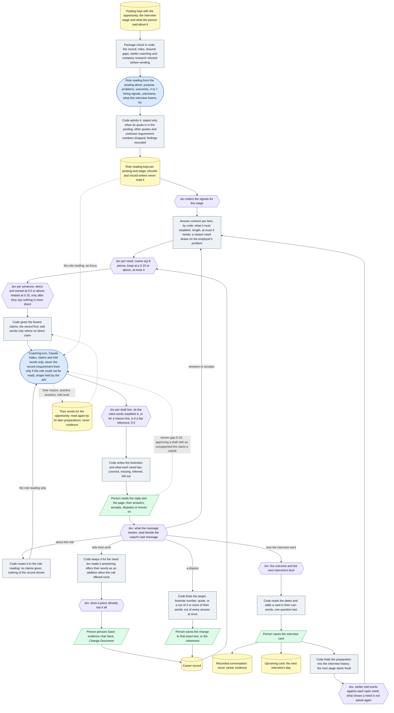

# Architecture 08 — Interview coach

*Live `00eac95` (2026-10-31) · narrative: [Applications 05](../applications/05-research-and-interview-prep.md#interview-coach)*

One coaching turn runs from the posting down to the person. The side loops are what their next
message can start: a question about the role, told work, a dispute, or a debrief after an
interview.

**What to notice:**
- **The posting itself reaches one call, and the record never reaches that call.** The role
  reading sees the posting alone, checked in code before sending ([A-62](../evidence/03-claim-index.md#a-62)). The
  coaching turn sees only the claims Jev chose and what the person told: never the record, and
  the posting's requirement lines only when the role could not be read ([A-63](../evidence/03-claim-index.md#a-63)).
- **Jev decides; the models read and write.** Signal order, claims, line checks and what a message
  means are Jev's ([A-66](../evidence/03-claim-index.md#a-66);
  [DEC-43](../product/07-decision-log.md#dec-43)). Footnotes and coverage are code's
  ([A-64](../evidence/03-claim-index.md#a-64)). A reason is checked as an inference, not as a fact
  ([A-68](../evidence/03-claim-index.md#a-68)).
- **Every change to the record is a person's Save.** Told work is offered by code
  ([A-65](../evidence/03-claim-index.md#a-65)); a dispute is resolved by code and offered as an
  exact-text change ([A-69](../evidence/03-claim-index.md#a-69)). No model call writes to the
  record, and the coaching call can propose only an addition, never a removal.
- **Two stores that are not evidence.** The interview card becomes a recorded conversation and an
  Upcoming date ([A-67](../evidence/03-claim-index.md#a-67),
  [A-72](../evidence/03-claim-index.md#a-72)). The person's words for the opportunity are kept with
  it and are never evidence; the application chat also reads stated reasons from every opportunity
  ([A-70](../evidence/03-claim-index.md#a-70), [D-34](../evidence/05-discrepancies.md#d-34)).
- **One contract for every stage.** The debrief loop returns to the same contract for the next
  interview, with the history as context ([A-67](../evidence/03-claim-index.md#a-67)).
- **One dotted edge is a known gap.** Approving a draft that has an unsupported line marks it stale
  and the coach writes it again: a check starting a rewrite
  ([D-31](../evidence/05-discrepancies.md#d-31)).

**Not shown, because no page links to them since `2c05495`:** the round preparation, Quick answers
and the walkthrough, which still answer at their addresses
([A-52](../evidence/03-claim-index.md#a-52)–[A-54](../evidence/03-claim-index.md#a-54),
[D-39](../evidence/05-discrepancies.md#d-39)).
